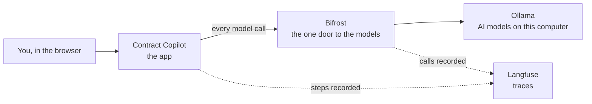

# PayNest Contract Copilot

A fully local, air-gapped AI copilot that reviews **client contracts** against a company's
**Contracting Standards**: plain-English summary, chat with page citations, a 10-standard review with a
0–100 risk score, a lawyer's sign-off and an Issues List for negotiation. **No byte leaves the machine.**

PayNest Technologies, its clients and its contracts are fictional, made for teaching.

**Presentation:** https://anjanimalhotra.github.io/legal-docs-review/

## Run it

```bash
./start.sh               # starts every portal
docker compose down      # stops them
```

The first run downloads about 10 GB and needs the internet. Needs 16 GB of RAM.

## Read more

| | |
|---|---|
| Learn it in 4 steps (one branch and one notebook per step) | [STEPS.md](STEPS.md) |
| Logins for Langfuse and Bifrost (local, educational) | [credentials.md](credentials.md) |
| The business and its clients | [docs/1_company_and_clients.md](docs/1_company_and_clients.md) |
| The company policy the tool checks against | [policies/PayNest_Contracting_Standards.md](policies/PayNest_Contracting_Standards.md)  |
| How it works | [docs/3_architecture.md](docs/3_architecture.md)  |
| The tools and every file | [docs/4_tech_stack.md](docs/4_tech_stack.md)  |

## How it fits together



The app never talks to a model directly. Every call goes through Bifrost, and every step is recorded in Langfuse.
All of it runs on one computer, so no contract leaves it.

## The stack

Ollama (Qwen 2.5 7B, Llama 3.1 8B, nomic-embed-text) · Bifrost gateway · self-hosted Langfuse · LangGraph ·
Chroma · FastAPI · plain HTML/CSS/JS · Ragas. Everything runs in Docker on one machine.

## Folders

```
copilot/       the app: code, settings, prompts, web UI, tests, evals, sample contracts
notebooks/     standalone demos of the logic, with their own demo data and saved outputs
docker-compose.yml  starts every service
infra/         Bifrost and Langfuse config
docs/          supporting docs
policies/      PayNest Contracting Standards (generated from copilot/config/standards/)
presentation/  the teaching deck (published on GitHub Pages)
website/       PayNest's marketing site
```
