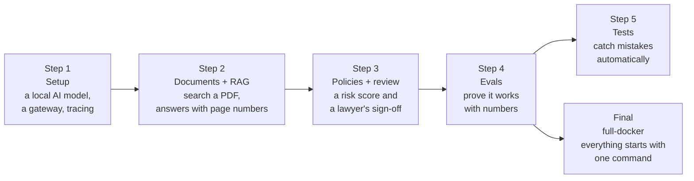

# Learning Path: Build the Contract Copilot in 4 Steps

The project is built up in four steps, and a fifth branch (`full-docker`) packages the finished project. Each one is a **branch** (and a matching **tag**) in this
repository, and each adds to the one before. Check out any step and you get a project that runs at that stage.



| Step | Branch / tag | What you learn | Run it | Notebook |
|---|---|---|---|---|
| **1** | `step-1-setup` / `v1-setup` | Talk to a local LLM through a gateway, and see every call traced | `make smoke` | `01_hello_llm.ipynb` |
| **2** | `step-2-rag` / `v2-rag` | Turn a PDF into searchable clauses; answer questions with page citations | `make up` → http://localhost:8000/api/docs | `02_rag.ipynb` |
| **3** | `step-3-review-agent` / `v3-review-agent` | Encode company policy; an agent applies it; Python verifies and scores; a lawyer signs off | `make up` → http://localhost:8000 (the full portal) | `03_review_agent.ipynb` |
| **4** | `step-4-evals` / `v4-evals` | Prove the quality with an answer key, a judge model and Ragas | `make evals ARGS="--contract lexmore"` | `04_evals.ipynb` |
| **5** | `step-5-tests` | Protect the project with simple tests on real contracts, attacks and the golden rules | `make test-step5` | none |

## Switching steps

```bash
git checkout step-2-rag                 # look at step 2
git checkout -b my-work v2-rag          # start your own work from step 2
git checkout full-docker               # the finished project, packaged in Docker
```

After switching, reinstall the Python packages if the step added new ones:
```bash
cd copilot && .venv/bin/pip install -r requirements.txt
```

## What each step adds

**Step 1 · Setup.** The model plumbing (`app/core/`), the gateway and tracing infrastructure (`infra/`),
`config/settings.yaml` with two model roles (analyst, embed), the setup scripts, `SETUP.md`, the company background
(`docs/1_company_and_clients.md`, `docs/glossary.md`), the marketing website and the first notebook (`notebooks/`).

**Step 2 · Documents + RAG.** PDF ingestion and clause chunking (`app/ingest/`), embeddings and the vector
store, hybrid retrieval, cited chat answers and the key-terms summary (`app/rag/`), the document API routes,
the sample contracts and the second notebook.

**Step 3 · Policies + review agent.** PayNest's Contracting Standards (`config/standards/`, `policies/`), the
classifier, grounding guard, stricter-only checks, scoring, lawyer decisions and the Issues List
(`app/policy/`), the LangGraph workflow with its human gate (`app/graph/`), the full web portal (`web/`),
the case studies and architecture docs, and the third notebook.

**Step 4 · Evals.** The answer key and eval runner (`evals/`), the judge model role and Ragas, the tech
stack doc, the fourth notebook and the teaching presentation (`presentation/`, also published on GitHub Pages).

**Step 5 · Tests.** Step 4 plus `copilot/tests/step5/`: nine short files, each about one idea. The tests from
steps 1 to 4 stay where they are. `make test-step5` needs no models; `make test-live` uses the real ones.

## Running a step

Follow [SETUP.md](SETUP.md) once. It describes the finished project, so on earlier steps stop where the step ends:
step 1 after section 5 (there is no app yet), and step 2 at `/api/docs` (the web portal arrives in step 3).
Notebooks live in `notebooks/` and start with `cd copilot && make notebook`.

The finished project, packaged in Docker, is the `full-docker` branch: run `./start.sh` from its project root.
