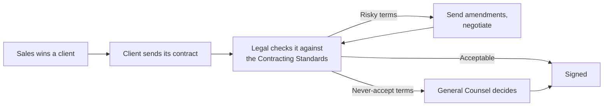

# 1 · The Company and Its Clients

Everything you need to know about the business before reading the code. No legal background assumed.

> PayNest Technologies and all its clients are **fictional**. Any resemblance to real companies is accidental.

---

## 1. PayNest Technologies Pvt. Ltd.

| | |
|---|---|
| **What** | A **private payroll provider**: runs payroll for other companies on its own infrastructure |
| **Where** | Bengaluru (head office and main data centre), Pune (backup data centre) |
| **Size** | ~450 employees; ~400 client companies; ~2 lakh employees' payroll every month |
| **Promise** | **"Your payroll data never leaves PayNest."** No public cloud, no outside processors, no outsourced support |
| **Legal team** | 3 people, reviewing **60+ client documents a month** |

### What PayNest sells

| Service | In simple words |
|---|---|
| Payroll processing | Calculates every employee's salary each month |
| Payslips | Creates and sends monthly salary slips |
| Tax (TDS) | Works out and deducts income tax from salaries |
| PF / ESI filings | Files government contributions (retirement, health insurance) |
| Attendance and leave | Tracks attendance and leave, which affect salary |
| Employee self-service app | Employees view payslips and download tax forms |
| Salary disbursement | Sends the salary file **directly** to the client's bank over a secure link |

**Business model.** A subscription per employee per month (e.g. ₹80), a one-time setup fee, and a
**premium for privacy**: PayNest charges more than cloud payroll competitors because it runs everything itself.

### How PayNest keeps its promise

| Area | How it works |
|---|---|
| **Hosting** | PayNest-owned servers in its own data centre. No AWS, Azure or Google Cloud |
| **Backups** | Copied to PayNest's own Pune data centre, on a fixed rotation |
| **Support** | PayNest employees in PayNest offices; no outsourced call centre |
| **Staff tools** | Staff may **not** use ChatGPT or any cloud AI for work |
| **Security** | ISO 27001 certified; yearly third-party audit; strict access control |

> **The founding story:** in 2023 British Airways, the BBC and Boots lost staff payroll data because their
> payroll provider's file-transfer *vendor* was hacked (Zellis/MOVEit, see [2_case_studies.md](2_case_studies.md)).
> PayNest's pitch: **"With us, there is no vendor's vendor."**

## 2. Who the clients are

Privacy-sensitive organisations that chose PayNest *because* it is private:

| Client type | Example (fictional) | What their contracts tend to demand |
|---|---|---|
| Hospital chains | CareWell Hospitals | Unlimited liability for data breaches, "notify immediately" |
| Co-operative banks | Northstar Bank | Regulator and auditor access "at any time", sharing of security reports |
| Law firms | Lexmore & Associates | Usually fair terms; long payment cycles |
| Retail and logistics | BrightRetail, Meridian Freight | Short, incomplete contracts; foreign law; long payment terms |
| Tech companies (pilots) | Orbit Analytics | Short trials on dummy data |

## 3. The legal documents PayNest receives

Almost all legal work comes **from clients**: PayNest is the one being hired.

| Document | What's in it |
|---|---|
| **MSA / services agreement** | The main legal terms: liability, indemnity, service levels, termination |
| **DPA** (data processing agreement) | How PayNest handles employees' data: breach notice, deletion, audits |
| **Order form / SOW** | The deal itself: number of employees, price, start date |
| **Pilot agreement** | A short trial, usually on dummy data |
| **Renewal / amendment** | Price changes and new demands from existing clients |

**"Client paper" is where the risk is.** Big clients insist on their *own* contract template, written in
*their* favour. One bad clause can cost more than the whole deal is worth.

### How a contract is reviewed

The Contract Copilot speeds up step **C**: a fast, consistent, cited first pass and a drafted Issues List.
Negotiation and decisions stay with people.

## 4. The 10 things every contract is checked for

The full company policy is in [../policies/PayNest_Contracting_Standards.md](../policies/PayNest_Contracting_Standards.md).

| # | Clause | In plain English | A risky client clause looks like |
|---|---|---|---|
| P1 | **Liability cap** | The most PayNest pays if something goes wrong | "Provider's liability shall be **unlimited**." |
| P2 | **Indemnity** | PayNest pays the client's costs if someone sues them | "…against **any and all claims**…" |
| P3 | **Breach notice** | How fast PayNest must report a data incident | "Provider shall notify Client **immediately**." |
| P4 | **Service levels** | Promised uptime and penalties if missed | "99.99% uptime; Provider pays **all losses**." |
| P5 | **Audit rights** | When the client can inspect PayNest | "…may audit **at any time without notice**." |
| P6 | **Data return / deletion** | What happens to data when the client leaves | "…delete all data, **including backups, within 3 days**." |
| P7 | **Confidentiality** | Who must keep what secret | "…**share security reports with Client's service providers**." |
| P8 | **Payment terms** | When PayNest gets paid | "Payment within **120 days**, subject to Client's satisfaction." |
| P9 | **Termination** | How each side can exit | "…terminate on **7 days' notice** with a **full refund**." |
| P10 | **Governing law** | Which law and courts apply | "Governed by the laws of **Singapore**." |

Each standard has three positions: **Ideal** (what PayNest wants), **Can accept** (after negotiation)
and **Never accept** (only with senior approval), plus a rule for when the contract is **silent**.

## 5. Why one bad clause is so dangerous

1. **Payroll failures multiply.** One outage hits thousands of employees, and claims add up fast (Kronos/UKG).
2. **Unlimited liability can exceed the deal value many times over.** A ₹19 lakh/year contract could carry crores of exposure.
3. **Impossible promises are broken on day one.** "Notify immediately" is breached the moment PayNest spends an hour investigating.
4. **Some clauses break other contracts.** Sharing data with a client's vendors breaks PayNest's promise to every other client.

## 6. Why the AI has to run on PayNest's own machines

Client contracts contain confidential details (employee counts, salary bands, security requirements,
pricing) that PayNest has promised never to share. Pasting one into a cloud chatbot would break the
exact promise PayNest sells (see Samsung in the case studies). **So every model, the gateway, the
tracing and the evaluation run on PayNest's hardware, the same way PayNest runs payroll.**

## 7. Who uses the tool

| Role | What they need from it |
|---|---|
| **Legal Counsel** (main user) | A fast, cited first pass, a risk rating and a draft Issues List |
| **General Counsel** | An audit trail, and a pause on every high-risk item for a human decision |
| **CFO** | Liability, indemnity, service-level and payment findings (P1, P2, P4, P8) |
| **CISO** | Breach-notice, audit, deletion and confidentiality findings (P3, P5, P6, P7) |
| **Sales** | Faster turnaround and a clear list of what to negotiate |

**What the tool does not do:** give legal advice, draft contracts, connect to email, or check against
any law or regulation. It flags risk against PayNest's own policy, and a lawyer decides.
