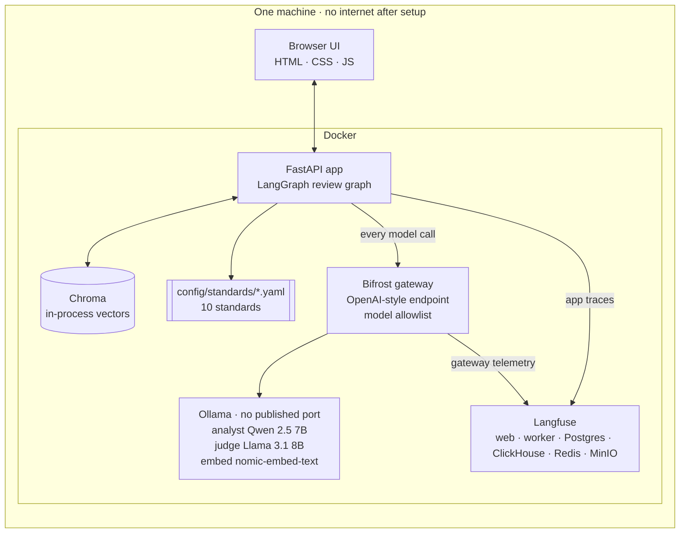
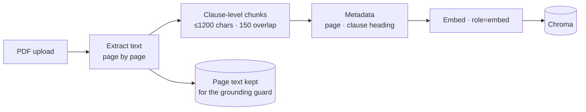
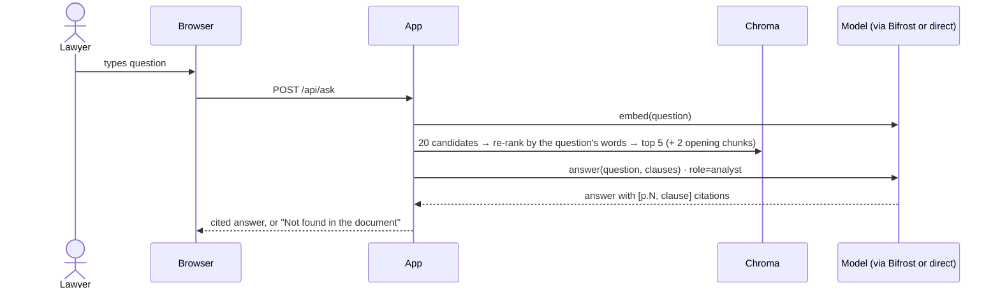
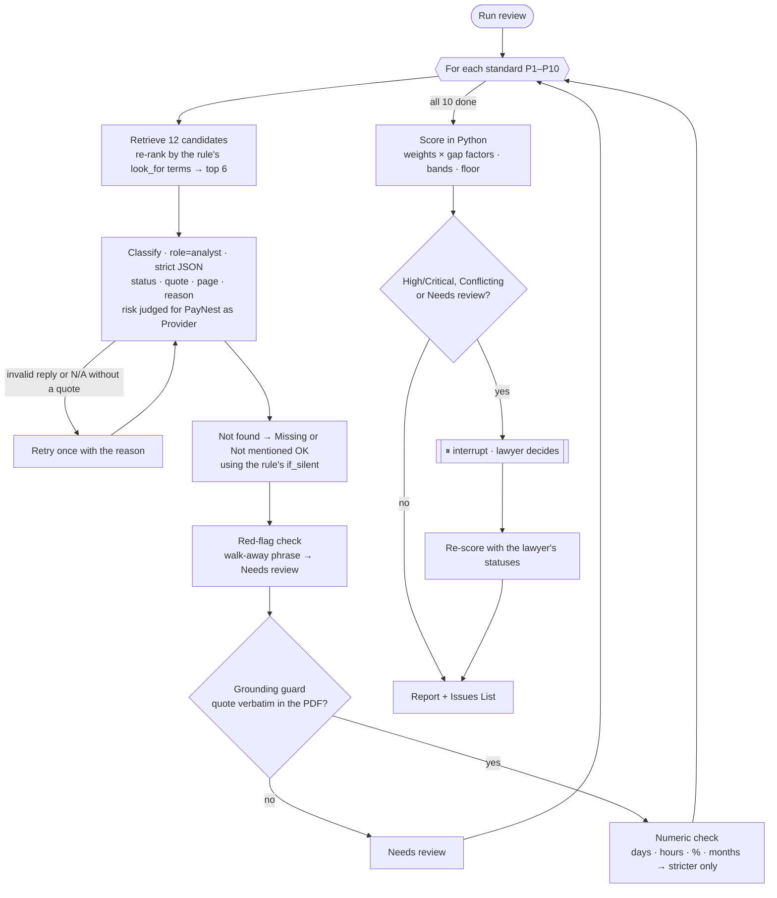
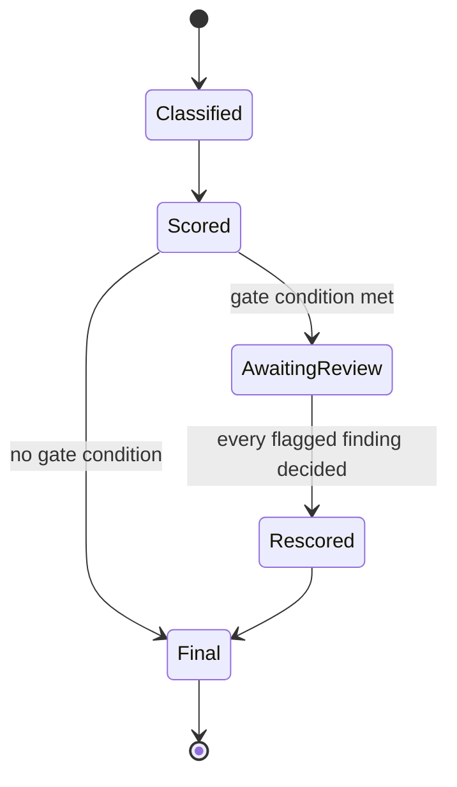

# 3 · Architecture

The copilot runs on one machine: **browser UI → FastAPI app (LangGraph review graph) → Ollama models**,
optionally through the **Bifrost gateway**, with **Langfuse + Ragas** for observability. **Nothing talks to the internet.**

> Diagrams use Mermaid. In VS Code, install *Markdown Preview Mermaid Support* to see them rendered.
> Tools and the file-by-file walkthrough: [4_tech_stack.md](4_tech_stack.md). The rules themselves: [../policies/PayNest_Contracting_Standards.md](../policies/PayNest_Contracting_Standards.md).

---

## 1. Design principles

| # | Principle | What it means in practice |
|---|---|---|
| 1 | **Nothing leaves the machine** | Models, vectors and traces are all local. Models are pulled once at setup; no egress afterwards. |
| 2 | **The app never names a model** | Code asks for a *role* (`analyst`, `judge`, `embed`). `config/settings.yaml` maps role → model. Swapping a model is a config change. |
| 3 | **The LLM reads; Python decides** | The LLM only labels a clause. Checks, score, band and floor are plain Python, so the same labels always give the same score. |
| 4 | **Every claim points to a page** | Each chunk keeps its page and clause heading. Each finding carries a verbatim quote, and a guard checks the quote exists. |
| 5 | **Humans sign off on risk** | Risky findings pause the workflow (a LangGraph interrupt) until a lawyer decides. |
| 6 | **The judge is from a different family** | The eval judge (Llama) is not from the classifier's family (Qwen), so the system never grades its own homework. |
| 7 | **Fail loudly** | No fallback model. If the analyst fails, the user sees an error rather than a silently weaker answer. |

## 2. How it runs (full Docker)

`docker-compose.yml` starts every box above except the browser. Every call goes through Bifrost and appears
in Langfuse, and Ollama publishes no port, so nothing else can reach the models. Docker on a Mac cannot use
the Apple GPU, so models run on the CPU there; on Linux with an NVIDIA GPU, turn on `gpus: all`.

## 3. The model roles

| Role | Model | Job | Why |
|---|---|---|---|
| `analyst` | Qwen 2.5 7B Instruct | Summary, chat answers and standards classification (strict JSON, temperature 0) | Follows a schema well; fits in 8 GB |
| `judge` | Llama 3.1 8B | Ragas scores for chat answers (evals only) | Different family from the analyst |
| `embed` | nomic-embed-text | Embeddings for chunks and queries (`search_document:` / `search_query:` prefixes) | Small, local, good retrieval |

## 4. Flow: upload

## 5. Flow: chat question

## 6. Flow: the standards review (LangGraph)

### Classifier output contract (per standard)

| Field | Notes |
|---|---|
| `status` | Compliant · Partial · Conflicting · Not found · N/A. `Missing`, `Silent (OK)` and `Needs review` are **never** produced by the LLM; Python sets them |
| `evidence_quote` | Verbatim from the contract; required for every status except Not found (including N/A) |
| `page`, `clause_ref` | Where the quote is, e.g. "15.2 Limitation of Liability" |
| `reason` | One plain-English sentence: ideal, can accept, or never accept, and why |

> **Perspective rule:** *"PayNest is the Provider. The client wrote the contract. Judge every clause by the risk
> it creates for PayNest."* Without it, a model may read "unlimited liability" as good, as the client would.

## 7. Human gate

Per flagged finding the lawyer can **Approve** (keep the status) or **Override** (new status, note required).
Each decision records name, time, old and new status: the audit trail.

## 8. How the risk score works

The model only labels each standard. **Python turns the labels into a score**, so the same labels always give the same number.

| Status (shown in the app as) | Gap *g* |
|---|:-:|
| Compliant (**OK**) | 0 |
| Partial (**Acceptable**) | 0.5 |
| Conflicting (**Not acceptable**) | 1 |
| Missing (**Missing**: silent, and silence is risky) | 1 |
| Silent (OK) (**Not mentioned (fine)**) | 0 |
| Needs review (**Needs a lawyer's check**) | 1, until a lawyer decides |
| N/A (**Doesn't apply**) | left out of the sum entirely |

$$\text{Risk} = 100 \times \frac{\sum w_i \cdot g_i}{\sum w_i} \quad \text{(weights from the policy, total 35)}$$

| Score | Band |
|---|---|
| 0–20 | 🟢 Low |
| 21–45 | 🟡 Medium |
| 46–70 | 🟠 High |
| 71–100 | 🔴 Critical |

- **Floor:** if a **key rule** (P1 liability, P2 indemnity, P3 breach notice) is Missing or Not acceptable, the band is **at least High**, whatever the number says.
- **Gate:** the review pauses for a lawyer if the band is High or Critical, or if any finding is Not acceptable or Needs a lawyer's check.
- **Worked example (CareWell):** P1 and P3 Not acceptable (5 + 5), P2, P4, P6, P8 Acceptable (2.5 + 2 + 1.5 + 1), the rest OK → 17 ÷ 35 → **49, High**.

## 9. Privacy and security

| Control | How |
|---|---|
| No egress | Models are downloaded once; after that nothing calls the internet. The live demo counts outside requests: 0 |
| One gate to the models | Every model call goes through Bifrost, which serves only the three allowed local models |
| No hosted tracing | Langfuse is self-hosted; LangSmith and telemetry are switched off |
| Audit trail | Every lawyer decision is stored with name, time, old and new status |
| No secrets in code | Keys live in `.env.local`, never in the repository |

## 10. Observability: who sees what

| Tool | Layer | Answers |
|---|---|---|
| Bifrost | Infrastructure | Which model served this call? How long did it take? Was the model allowed? |
| Langfuse | Application | Which steps ran? Which clauses were retrieved? What prompt went in? |
| Ragas | Quality | Is the chat answer faithful to the clauses? Did retrieval find the right ones? |

**Why not LangSmith:** it is hosted. Traces contain contract text, so they would leave the machine.
