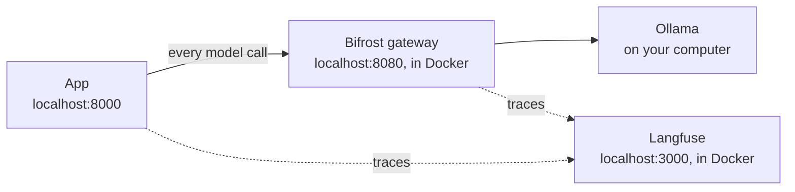

# Local infrastructure: Bifrost + Langfuse

The app and Ollama run natively (Ollama uses the Mac GPU); Bifrost and Langfuse run in Docker (Colima).



## Start

```bash
colima start --cpu 4 --memory 4 --disk 40
cd infra/langfuse && docker compose up -d                 # official compose file; secrets in .env
docker start paynest-bifrost                                 # created once, see "Bifrost container" below
ollama serve &                                               # if not already running
cd ../../copilot && make up                                # loads copilot/.env.local (gateway profile)
```

Langfuse UI: http://localhost:3000, Bifrost UI: http://localhost:8080. Both logins are in [../credentials.md](../credentials.md);
the organisation, project and API keys were created automatically on first start.

Create every secret file once with `copilot/scripts/create_secrets.sh` (see SETUP.md, step 4).

## Files (all local, never committed)

| File | Holds |
|---|---|
| `langfuse/docker-compose.yml` | Langfuse's official self-host compose, with web and MinIO ports bound to 127.0.0.1 |
| `langfuse/.env` | Generated secrets, `TELEMETRY_ENABLED=false`, first-run org, project, keys and login |
| `bifrost/config.json` | Ollama provider (`host.docker.internal`, `allow_private_network` for the host), `models` allowlist (analyst and embed only; update it when a model is swapped), OTel export to Langfuse, dashboard login (`admin`), and `enforce_auth_on_inference: false` so the app can call it without a key |
| `bifrost/.env` | `LANGFUSE_OTEL_AUTH` (Basic auth for the OTel exporter) and `BIFROST_ADMIN_PASSWORD` (dashboard login) |
| `../copilot/.env.local` | `SETTINGS_PROFILE=gateway`, Bifrost URL, Langfuse host and keys |

## Bifrost container (created once)

```bash
cd infra/bifrost
docker run -d --name paynest-bifrost --restart unless-stopped --network langfuse_default \
  -p 127.0.0.1:8080:8080 --add-host=host.docker.internal:host-gateway --env-file .env \
  -v "$PWD:/app/data" maximhq/bifrost:latest
```
