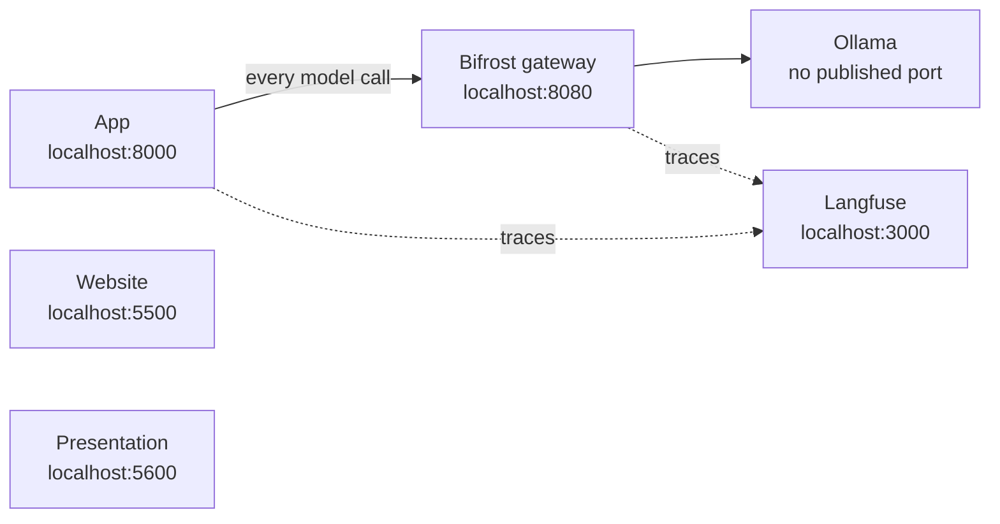

# Local infrastructure: full Docker

Every service runs in Docker from `../docker-compose.yml`. Start it with `./start.sh` from the project root.



Inside Docker the services find each other by name: `bifrost`, `ollama`, `langfuse-web`.

Langfuse UI: http://localhost:3000, Bifrost UI: http://localhost:8080. Both logins are in [../credentials.md](../credentials.md);
the organisation, project and API keys are created automatically on first start.

## When Docker cannot run the models

Models need more memory than Docker may have, and Docker on Windows or Mac may not reach the GPU. On such a machine, run
Ollama natively and leave the rest in Docker. The app can run in either place, and it reaches the models through Bifrost:

```bash
ollama pull qwen2.5:7b-instruct && ollama pull llama3.1:8b && ollama pull nomic-embed-text
docker compose -f docker-compose.yml -f docker-compose.native.yml up -d     # Bifrost, Langfuse, website, presentation
docker compose -f docker-compose.yml up -d --no-deps app                    # the app, in Docker
# or natively instead: copilot/scripts/run.sh  (settings from copilot/.env.local)
docker compose exec -T app python scripts/push_prompts.py                   # load the prompts into Langfuse (first time)
```

`bifrost/config.native.json` is `bifrost/config.json` with the native Ollama address. Change both when a model is swapped.
Do not use plain `docker compose up` or `./start.sh` on such a machine: they start the Docker Ollama again.

## Files

| File | Holds |
|---|---|
| `../docker-compose.yml` | Every service, with ports bound to 127.0.0.1. Includes Langfuse's file below |
| `../copilot/Dockerfile` | Builds the app image; `.dockerignore` keeps secrets and contracts out |
| `langfuse/docker-compose.yml` | Langfuse's official self-host compose, with web and MinIO ports bound to 127.0.0.1 |
| `langfuse/.env` | Generated secrets, `TELEMETRY_ENABLED=false`, first-run org, project, keys and login (never committed) |
| `bifrost/config.json` | File-only config: Ollama provider, `models` allowlist (analyst, judge, embed only; update it when a model is swapped), OTel export to Langfuse |
| `bifrost/.env` | `LANGFUSE_OTEL_AUTH`, Basic auth for the OTel exporter (never committed) |
| `../copilot/.env.local` | Langfuse keys for the app (never committed) |
